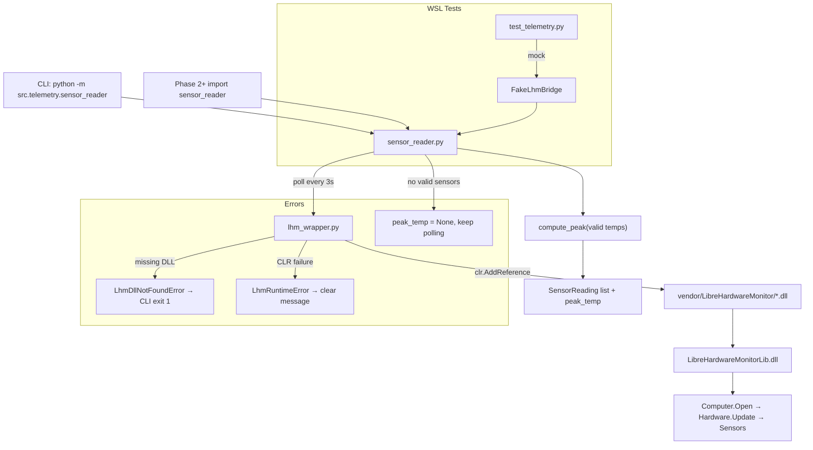

# Phase 1: Telemetry Foundation - Research

**Researched:** 2026-08-16
**Domain:** Python/pythonnet bridge to LibreHardwareMonitorLib.dll for Windows CPU/GPU temperature polling
**Confidence:** HIGH

## Summary

Phase 1 builds a Windows-only telemetry layer that loads `LibreHardwareMonitorLib.dll` via pythonnet, polls every 3 seconds, and exposes all active CPU/GPU `Temperature` sensors plus a single peak value. The project is greenfield — no `src/` code exists yet; locked decisions in `01-CONTEXT.md` (D-01 through D-22) fully constrain design.

LibreHardwareMonitor's `Hardware.Sensors` property returns only **active** sensors (`_active.ToArray()`), so D-06 is satisfied by iterating `Sensors` without extra filtering [VERIFIED: LibreHardwareMonitor v0.9.6 `Hardware.cs`:78-82]. GPU hardware types are `GpuNvidia`, `GpuAmd`, and `GpuIntel`; CPU is `Cpu` [VERIFIED: `HardwareType.cs`:14-18]. Temperature sensors use `SensorType.Temperature` [VERIFIED: `ISensor.cs`/`SensorType` enum: `Temperature, // °C`]. Each poll must call `hardware.Update()` (and recurse `SubHardware`) before reading values — the official LHM sample uses an `UpdateVisitor` pattern [CITED: github.com/LibreHardwareMonitor/LibreHardwareMonitor README].

Pin **LibreHardwareMonitor v0.9.6** (latest stable release, Feb 2026). The GitHub release asset `LibreHardwareMonitor.zip` contains `LibreHardwareMonitorLib.dll`, `HidSharp.dll`, and all net472 dependency DLLs at archive root [VERIFIED: GitHub API release tags/v0.9.6 assets + zip listing this session]. WSL2 development runs **mocked unit tests only** (D-15); real sensor verification happens on the Windows target machine.

**Primary recommendation:** Implement a thin `lhm_wrapper.py` (DLL load + LHM lifecycle + sensor enumeration) and `sensor_reader.py` (3s poll, peak aggregation, CLI) with dependency injection at the wrapper boundary so WSL tests never import `clr`.

<user_constraints>
## User Constraints (from CONTEXT.md)

### Locked Decisions

#### Sensor Selection
- **D-01:** Include every LibreHardwareMonitor sensor with type `Temperature` on CPU and GPU hardware nodes when computing peak — **Reversibility:** costly — changing the filter later affects peak semantics and alert thresholds downstream
- **D-02:** GPU peak contribution = maximum across all detected GPUs (integrated + discrete) — **Reversibility:** reversible
- **D-03:** CPU peak contribution = maximum across all CPU sockets/packages — **Reversibility:** reversible
- **D-04:** Expose sensor names with hardware prefix (e.g., `CPU / Package`, `GPU / Hot Spot`) for downstream tray menu clarity — **Reversibility:** reversible
- **D-05:** Auxiliary temperature sensors (VRM, memory, hotspot, etc.) count toward peak if LHM reports them as type `Temperature` — **Reversibility:** reversible
- **D-06:** Skip sensors LHM marks inactive; do not include them in peak calculation — **Reversibility:** reversible
- **D-07:** Skip individual readings ≤0°C or >150°C when computing peak; log a WARNING once per sensor on first invalid value, suppress repeats until valid again — **Reversibility:** reversible
- **D-08:** When all sensors are skipped or invalid, set `peak_temp = None` (unknown); downstream phases must not alert on unknown peak — **Reversibility:** one-way — alert engine will depend on None semantics as "no data"
- **D-09:** No smoothing or debounce in Phase 1 — each 3-second poll computes peak independently from current valid readings — **Reversibility:** reversible
- **D-10:** No separate staleness timeout — trust LHM fresh read each poll cycle — **Reversibility:** reversible
- **D-11:** Partial sensor failure: compute peak from remaining valid sensors only; do not expose a separate "degraded" health flag in Phase 1 — **Reversibility:** reversible

#### Phase 1 Dev Output & Testing
- **D-12:** Deliver both a runnable CLI (`python -m src.telemetry.sensor_reader`) and importable API (`lhm_wrapper`, `sensor_reader` modules) for Phase 2+ integration — **Reversibility:** reversible
- **D-13:** CLI prints timestamp, every sensor name + value, and peak summary every poll cycle (3s) — matches manual Windows verification need — **Reversibility:** reversible
- **D-14:** Log to stdout only in Phase 1; no rotating log file yet — **Reversibility:** reversible
- **D-15:** WSL2 development uses mocked LHM unit tests only; real sensor verification runs on Windows target machine — **Reversibility:** reversible
- **D-16:** CLI poll loop runs continuously until Ctrl+C — **Reversibility:** reversible

#### LHM DLL Provisioning
- **D-17:** Bundle `LibreHardwareMonitorLib.dll` under `vendor/LibreHardwareMonitor/`, populated by `scripts/fetch-lhm.ps1` from official LHM release — **Reversibility:** costly — PyInstaller bundling in Phase 4 depends on vendor layout
- **D-18:** Document that admin elevation may be required once for full GPU/driver sensor access; do not hard-fail if running non-admin — **Reversibility:** reversible
- **D-19:** Missing DLL: log actionable error (run `fetch-lhm.ps1`), CLI exits with code 1, API raises typed exception; no crash/stack trace dump — **Reversibility:** reversible
- **D-20:** Document required .NET runtime version for pythonnet; clear error message if DLL load fails due to missing runtime — **Reversibility:** reversible
- **D-21:** Pin a specific stable LibreHardwareMonitor release version in `fetch-lhm.ps1`; document pinned version in README — **Reversibility:** reversible
- **D-22:** DLL loads but zero temperature sensors found: log clear message, keep polling every 3s (hardware may appear later), `peak_temp = None` — **Reversibility:** reversible

### Claude's Discretion

None — user made explicit choices for all presented options.

### Deferred Ideas (OUT OF SCOPE)

None — discussion stayed within phase scope.
</user_constraints>

<phase_requirements>
## Phase Requirements

| ID | Description | Research Support |
|----|-------------|------------------|
| TELE-01 | Application reads all CPU temperature sensors via LibreHardwareMonitor every 3 seconds | `HardwareType.Cpu` + `SensorType.Temperature` filter; 3s poll loop; `hardware.Update()` each cycle |
| TELE-02 | Application reads all GPU temperature sensors via LibreHardwareMonitor every 3 seconds | `GpuNvidia`, `GpuAmd`, `GpuIntel` hardware types + `SensorType.Temperature`; same poll loop |
| TELE-03 | Application computes and exposes the maximum current temperature across all CPU and GPU sensors | Peak = `max(valid_readings)` after D-06/D-07 filters; `None` when empty (D-08) |
</phase_requirements>

## Architectural Responsibility Map

| Capability | Primary Tier | Secondary Tier | Rationale |
|------------|-------------|----------------|-----------|
| LHM DLL load & .NET interop | API / Backend (local Python process) | OS (.NET runtime) | pythonnet + CLR live in the Python process; requires Windows + .NET |
| Sensor discovery & read | API / Backend | — | Business logic in `lhm_wrapper.py`; no UI in Phase 1 |
| Peak aggregation & validation | API / Backend | — | Pure Python in `sensor_reader.py`; consumed by Phase 2 alerts |
| 3-second poll loop | API / Backend | — | CLI loop + future orchestrator; not browser/client |
| DLL provisioning | Build/Deploy script | CDN (GitHub releases) | `fetch-lhm.ps1` populates `vendor/` at dev/build time |
| Unit tests (WSL) | Dev/test harness | — | Mock wrapper boundary; no hardware access on Linux |

## Standard Stack

### Core

| Library | Version | Purpose | Why Standard |
|---------|---------|---------|--------------|
| pythonnet | 3.1.0 (pin `>=3.0.3,<4.0` per requirements) [VERIFIED: PyPI API this session] | Python ↔ .NET CLR bridge for LHM DLL | Project-locked in `requirements.txt`; only viable path to LHM from Python |
| LibreHardwareMonitorLib | 0.9.6 (pin in `fetch-lhm.ps1`) [VERIFIED: GitHub release tag v0.9.6] | CPU/GPU temperature sensor access | Official library; broad hardware coverage vs WMI |
| HidSharp | 2.6.4 (bundled with LHM 0.9.6) [VERIFIED: NuGet nuspec librehardwaremonitorlib/0.9.6] | USB/HID dependency of LHM | Required co-load with LHM DLL [CITED: turing-smart-screen-python pattern] |

### Supporting

| Library | Version | Purpose | When to Use |
|---------|---------|---------|-------------|
| pytest | 9.1.1 [VERIFIED: PyPI API this session] | Unit test runner | WSL mocked tests (add `requirements-dev.txt`) |
| pytest-mock | latest stable [ASSUMED] | Mock injection helpers | Mock `LhmBridge` in tests |

### Alternatives Considered

| Instead of | Could Use | Tradeoff |
|------------|-----------|----------|
| pythonnet + LHM DLL | WMI/OpenHardwareMonitor WMI namespace | Locked out — PROJECT.md chose LHM for GPU coverage |
| GitHub release zip | NuGet package install in fetch script | Zip is simpler (no NuGet CLI required); both ship same 0.9.6 binaries |
| CoreCLR explicit load | Default .NET Framework on Windows | LHM net472 build works with Windows-default pythonnet runtime [CITED: pythonnet docs] |

**Installation:**

```bash
pip install -r requirements.txt
pip install pytest pytest-mock   # dev — add requirements-dev.txt in Wave 0
```

**Version verification:**

```bash
curl -sL https://pypi.org/pypi/pythonnet/json | python3 -c "import sys,json; print(json.load(sys.stdin)['info']['version'])"
# → 3.1.0

curl -sL https://api.github.com/repos/LibreHardwareMonitor/LibreHardwareMonitor/releases/tags/v0.9.6 \
  | python3 -c "import sys,json; print([a['name'] for a in json.load(sys.stdin)['assets']])"
# → ['LibreHardwareMonitor.NET.10.zip', 'LibreHardwareMonitor.zip']
```

## Package Legitimacy Audit

> Required — Phase 1 installs external Python packages.

| Package | Registry | Age | Downloads | Source Repo | Verdict | Disposition |
|---------|----------|-----|-----------|-------------|---------|-------------|
| pythonnet | PyPI | mature | unknown (seam) | https://github.com/pythonnet/pythonnet | SUS | Approved — official project; seam flagged `unknown-downloads` only |
| pytest | PyPI | mature | unknown (seam) | https://github.com/pytest-dev/pytest | SUS | Approved — dev-only; seam flagged `unknown-downloads` only |
| pytest-mock | PyPI | mature | unknown (seam) | https://github.com/pytest-dev/pytest-mock | SUS | Approved — dev-only |
| LibreHardwareMonitorLib | NuGet/GitHub | v0.9.6 Feb 2026 | N/A (not PyPI) | https://github.com/LibreHardwareMonitor/LibreHardwareMonitor | OK | Approved — vendored DLL, not pip-installed |

**Packages removed due to [SLOP] verdict:** none

**Packages flagged as suspicious [SUS]:** pythonnet, pytest, pytest-mock — seam lacks download stats; all are established official packages. No `checkpoint:human-verify` needed beyond normal review.

**Postinstall scripts:** none detected on pythonnet via seam.

## Architecture Patterns

### System Architecture Diagram



### Recommended Project Structure

```
src/
├── telemetry/
│   ├── __init__.py
│   ├── lhm_wrapper.py      # DLL path, clr load, Computer lifecycle, sensor enumeration
│   ├── sensor_reader.py    # Poll loop, peak logic, CLI entry, public API types
│   └── exceptions.py       # LhmDllNotFoundError, LhmRuntimeError (optional split)
vendor/
└── LibreHardwareMonitor/   # *.dll from fetch-lhm.ps1 (gitignored or committed — planner decides)
scripts/
└── fetch-lhm.ps1           # Download v0.9.6 zip, extract DLLs
tests/
└── test_telemetry.py       # Mocked tests — no clr import on WSL
```

### Pattern 1: Lazy LHM Bridge with Injectable Backend

**What:** Separate DLL loading (side-effectful) from pure peak/validation logic.

**When to use:** Always — required by D-15 (WSL mocks) and D-12 (importable API).

**Example:**

```python
# Source: Context7 /pythonnet/pythonnet + LHM official sample
from dataclasses import dataclass
from typing import Protocol

@dataclass(frozen=True)
class SensorReading:
    name: str          # e.g. "CPU / Package" per D-04
    value_celsius: float

class LhmBackend(Protocol):
    def read_temperatures(self) -> list[SensorReading]: ...

class LhmBridge(LhmBackend):
    def __init__(self, vendor_dir: Path):
        self._computer = None
        self._vendor_dir = vendor_dir

    def open(self) -> None:
        import clr  # lazy — never imported in WSL unit tests
        sys.path.append(str(self._vendor_dir))
        clr.AddReference(str(self._vendor_dir / "LibreHardwareMonitorLib"))
        clr.AddReference(str(self._vendor_dir / "HidSharp"))
        from LibreHardwareMonitor.Hardware import Computer, HardwareType, SensorType
        # ... Open(), store computer handle

    def read_temperatures(self) -> list[SensorReading]:
        # Update all hardware + SubHardware, filter Cpu + Gpu* + Temperature
        ...
```

### Pattern 2: Recursive Hardware Update

**What:** Call `Update()` on each hardware node and recurse `SubHardware` before reading sensors.

**When to use:** Every poll cycle (D-09/D-10).

**Example:**

```python
# Source: LHM README UpdateVisitor pattern
def _update_hardware(hardware) -> None:
    hardware.Update()
    for sub in hardware.SubHardware:
        _update_hardware(sub)

def _iter_cpu_gpu_hardware(computer):
    CPU_GPU = {HardwareType.Cpu, HardwareType.GpuNvidia,
               HardwareType.GpuAmd, HardwareType.GpuIntel}
    for hw in computer.Hardware:
        if hw.HardwareType in CPU_GPU:
            yield hw
        for sub in hw.SubHardware:
            if sub.HardwareType in CPU_GPU:
                yield sub
```

### Pattern 3: Peak Computation with Locked Semantics

**What:** Apply D-06/D-07 filters, return `None` when no valid readings (D-08).

**Example:**

```python
MIN_C, MAX_C = 0, 150  # exclusive bounds per D-07 (>0 and <=150 valid)

def compute_peak(readings: list[SensorReading], warned: set[str]) -> float | None:
    valid = []
    for r in readings:
        if r.value_celsius <= MIN_C or r.value_celsius > MAX_C:
            if r.name not in warned:
                logging.warning("Invalid temperature for %s: %s", r.name, r.value_celsius)
                warned.add(r.name)
            continue
        warned.discard(r.name)  # reset suppress on valid again
        valid.append(r.value_celsius)
    return max(valid) if valid else None
```

### Pattern 4: fetch-lhm.ps1 Release Download

**What:** Pin version, download official zip, extract runtime DLLs to `vendor/LibreHardwareMonitor/`.

**Example:**

```powershell
# Source: GitHub API verified asset names for v0.9.6
$Version = "0.9.6"
$ZipUrl = "https://github.com/LibreHardwareMonitor/LibreHardwareMonitor/releases/download/v$Version/LibreHardwareMonitor.zip"
$Dest = Join-Path $PSScriptRoot ".." "vendor" "LibreHardwareMonitor"
# Invoke-WebRequest → Expand-Archive → Copy-Item *.dll from zip root to $Dest
```

Copy **all** root-level `*.dll` from the release zip (not only LHM + HidSharp) — the zip includes `DiskInfoToolkit.dll`, `RAMSPDToolkit-NDD.dll`, `System.*.dll`, etc. required at runtime [VERIFIED: zip listing this session].

### Anti-Patterns to Avoid

- **Importing `clr` at module top level in `sensor_reader.py`:** Breaks WSL tests and couples pure logic to Windows.
- **Using `install clr` PyPI package:** Wrong package — use `pythonnet` which provides `clr` [CITED: turing-smart-screen-python comment].
- **Reading sensors without `Update()`:** Stale/null values; CPU temps especially [CITED: LHM GitHub discussions].
- **Hard-failing on non-admin:** Violates D-18 — log advisory, continue with available sensors.
- **Catching bare `Exception` and printing stack trace:** Violates D-19 — catch load errors, emit actionable message, typed exception for API.

## Don't Hand-Roll

| Problem | Don't Build | Use Instead | Why |
|---------|-------------|-------------|-----|
| CPU/GPU temperature reads | WMI queries, psutil, ctypes hacks | LibreHardwareMonitorLib via pythonnet | GPU/aux sensor gaps on WMI; project-locked |
| .NET interop | ctypes/cffi on DLL exports | pythonnet `clr.AddReference` | LHM is .NET API, not C exports |
| Hardware driver access | Custom ring0/driver code | LHM's built-in drivers (incl. PawnIO) | Safety, maintenance, legal |
| DLL dependency resolution | Manual PE parsing | Co-locate all LHM release DLLs in vendor dir | .NET probes same directory |
| 3-second scheduling | Custom timer thread pool | `time.sleep(3)` in simple poll loop | Phase 1 scope; Phase 4 orchestrator may refine |

**Key insight:** LHM already solves the hard problem (hardware-specific sensor drivers). Phase 1 only wraps enumeration, filtering, and peak math in Python.

## Common Pitfalls

### Pitfall 1: CPU Temperatures Null Without Admin

**What goes wrong:** Sensors appear in list but `Value` is `None` or 0 for CPU while GPU works.

**Why it happens:** LHM requires elevated privileges for ring0/driver sensor access on many boards [CITED: LHM README, GitHub issues #1642, #1374].

**How to avoid:** Document admin requirement (D-18); do not treat as code bug; continue polling.

**Warning signs:** GPU temps OK, all CPU `Temperature` values null on Windows non-admin.

### Pitfall 2: Missing Dependency DLLs

**What goes wrong:** `LibreHardwareMonitorLib.dll` loads but `FileNotFoundException` for `HidSharp.dll` or `DiskInfoToolkit.dll`.

**Why it happens:** Only copying primary DLL, not full dependency set from release zip [VERIFIED: NuGet nuspec lists HidSharp, DiskInfoToolkit, RAMSPDToolkit-NDD, System.Management, etc.].

**How to avoid:** `fetch-lhm.ps1` copies all root `*.dll` from release zip to vendor dir.

**Warning signs:** CLR load succeeds, `Open()` throws on first hardware probe.

### Pitfall 3: Forgetting SubHardware

**What goes wrong:** Missing GPU hotspot/VRM temps that LHM nests under `SubHardware`.

**Why it happens:** Only iterating top-level `computer.Hardware.Sensors` [CITED: LHM README sample iterates SubHardware separately].

**How to avoid:** Recursive update + iterate sensors on both hardware and SubHardware nodes (D-05 auxiliary sensors).

**Warning signs:** LHM GUI shows more temps than CLI.

### Pitfall 4: pythonnet Runtime Mismatch

**What goes wrong:** `clr` import fails or `AddReference` throws `System.IO.FileNotFoundException` for .NET runtime.

**Why it happens:** .NET Framework 4.7.2+ not installed on target Windows machine [CITED: pythonnet docs — .NET Framework 4.6.1+ default on Windows].

**How to avoid:** Document requirement (D-20); catch load errors with message naming ".NET Framework 4.7.2 or later".

**Warning signs:** ImportError/DllNotFoundException before any sensor read.

### Pitfall 5: WSL Tests Accidentally Loading clr

**What goes wrong:** pytest on WSL tries to load .NET/Mono and fails or hangs.

**Why it happens:** Eager `import clr` or importing `lhm_wrapper` without mock patch.

**How to avoid:** Lazy-import clr inside `LhmBridge.open()`; tests inject `FakeLhmBackend` before importing reader logic (D-15).

**Warning signs:** Test collection fails on `import clr` on Linux.

### Pitfall 6: D-06 "Inactive" Misinterpreted

**What goes wrong:** Planner adds redundant `IsActive` checks that don't exist on `ISensor`.

**Why it happens:** `ISensor` has no public `IsActive` property [VERIFIED: `ISensor.cs` — properties are `Value`, `SensorType`, `Name`, etc.].

**How to avoid:** Rely on LHM's `_active` set — `hardware.Sensors` already excludes inactive sensors [VERIFIED: `Hardware.cs`:78-82 `get { return _active.ToArray(); }`]. Still skip `Value is None` for unavailable readings (distinct from D-07 invalid numeric range).

## Code Examples

### Load LHM DLL via pythonnet (Windows)

```python
# Source: Context7 /pythonnet/pythonnet — load by path via sys.path
import sys
from pathlib import Path

VENDOR = Path(__file__).resolve().parents[2] / "vendor" / "LibreHardwareMonitor"
DLL = VENDOR / "LibreHardwareMonitorLib.dll"

if not DLL.exists():
    raise LhmDllNotFoundError(
        f"LibreHardwareMonitorLib.dll not found at {DLL}. "
        "Run: pwsh scripts/fetch-lhm.ps1"
    )

sys.path.append(str(VENDOR))
import clr  # from pythonnet — NOT the standalone clr package
clr.AddReference("LibreHardwareMonitorLib")
clr.AddReference("HidSharp")
from LibreHardwareMonitor.Hardware import Computer, HardwareType, SensorType
```

### Initialize Computer (CPU + GPU only)

```python
# Source: LHM README sample — trimmed to Phase 1 scope
computer = Computer()
computer.IsCpuEnabled = True
computer.IsGpuEnabled = True
# Phase 1: disable unrelated groups to reduce noise/load
computer.IsMemoryEnabled = False
computer.IsMotherboardEnabled = False
computer.IsControllerEnabled = False
computer.IsNetworkEnabled = False
computer.IsStorageEnabled = False
computer.Open()
```

### Filter Temperature Sensors with Hardware Prefix (D-04)

```python
# HardwareType enum values: "Cpu", "GpuNvidia", "GpuAmd", "GpuIntel"
# SensorType enum: "Temperature" (value reads in °C)

PREFIX = {
    HardwareType.Cpu: "CPU",
    HardwareType.GpuNvidia: "GPU",
    HardwareType.GpuAmd: "GPU",
    HardwareType.GpuIntel: "GPU",
}

def format_name(hw, sensor) -> str:
    return f"{PREFIX[hw.HardwareType]} / {sensor.Name}"
```

### Mock Strategy for WSL Unit Tests (D-15)

```python
# tests/test_telemetry.py — no clr, no Windows
from src.telemetry.sensor_reader import compute_peak, SensorReading

class FakeBackend:
    def read_temperatures(self):
        return [
            SensorReading("CPU / Package", 72.0),
            SensorReading("GPU / Hot Spot", 68.0),
            SensorReading("CPU / Core #1", 999.0),  # invalid → skipped
        ]

def test_peak_excludes_invalid():
    readings = FakeBackend().read_temperatures()
    assert compute_peak(readings, set()) == 72.0

def test_peak_none_when_all_invalid():
    readings = [SensorReading("CPU / Package", -1.0)]
    assert compute_peak(readings, set()) is None
```

Patch `LhmBridge` factory in integration-style tests; keep `compute_peak`, name formatting, and warning-dedup as pure functions for fast WSL runs.

## State of the Art

| Old Approach | Current Approach | When Changed | Impact |
|--------------|------------------|--------------|--------|
| OpenHardwareMonitor | LibreHardwareMonitor fork | 2020+ | Use LHM namespace/API, not OpenHardwareMonitor |
| pythonnet 2.x implicit load | pythonnet 3.x explicit runtime optional | 2022+ | Windows default still works; CoreCLR available for .NET 8+ |
| LHM 0.9.4 | LHM 0.9.6 stable | Feb 2026 | Pin 0.9.6 in fetch script (D-21) |
| AnyCPU NuGet lib | x64-only NuGet after 0.9.5-pre481 | 2024+ | Use release zip DLLs or x64 build; target 64-bit Python on Windows [CITED: LHM issue #1920] |

**Deprecated/outdated:**
- OpenHardwareMonitorLib.dll — replaced by LibreHardwareMonitorLib.dll
- `pip install clr` — wrong; use `pythonnet`

## Assumptions Log

| # | Claim | Section | Risk if Wrong |
|---|-------|---------|---------------|
| A1 | Default pythonnet on Windows uses .NET Framework without explicit `load("coreclr")` for net472 LHM DLL | Standard Stack | May need explicit runtime config on some machines |
| A2 | Copying all root DLLs from `LibreHardwareMonitor.zip` satisfies runtime deps | fetch-lhm.ps1 | Missing satellite DLL → load failure at runtime |
| A3 | `sensor.Value is None` means unavailable reading (separate from D-07 numeric invalid) | Pitfall 6 | Edge-case sensors might behave differently |
| A4 | Prefix mapping uses `CPU`/`GPU` strings, not full `hardware.Name` | Pattern 3 | Tray display mismatch if user expected full device name |
| A5 | pytest/pytest-mock versions not yet pinned in repo | Standard Stack | CI reproducibility — add requirements-dev.txt |

## Open Questions

1. **Vendor DLLs in git vs gitignored**
   - What we know: D-17 requires `vendor/LibreHardwareMonitor/` layout; `.gitignore` does not currently exclude vendor [VERIFIED: `.gitignore`]
   - What's unclear: Whether to commit DLLs or require fetch before dev
   - Recommendation: Gitignore `vendor/*.dll`, document fetch in README; CI/Windows dev runs `fetch-lhm.ps1` first

2. **64-bit Python requirement**
   - What we know: LHM NuGet x64-only after 0.9.5 [CITED: issue #1920]; release zip DLLs are x64-oriented
   - What's unclear: Whether 32-bit Python ever needs support
   - Recommendation: Document 64-bit Python 3.10+ requirement; match PyInstaller Phase 4

## Environment Availability

| Dependency | Required By | Available (WSL dev) | Version | Fallback |
|------------|------------|---------------------|---------|----------|
| Python 3.10+ | All | ✓ | 3.12.3 | — |
| pip | Install deps | ✗ | — | `python3 -m ensurepip` or apt install |
| pythonnet | lhm_wrapper | ✗ (not installed) | 3.1.0 target | pip install on Windows dev machine |
| .NET Framework 4.7.2+ | LHM net472 DLL | ✗ | — | Windows target machine only |
| LibreHardwareMonitorLib.dll | lhm_wrapper | ✗ | 0.9.6 | `scripts/fetch-lhm.ps1` on Windows |
| PowerShell (pwsh) | fetch-lhm.ps1 | ✗ | — | Windows PowerShell 5.1 also works [ASSUMED] |
| pytest | WSL unit tests | ✗ | 9.1.1 | pip install in dev venv |

**Missing dependencies with no fallback:**
- Windows + .NET + LHM DLLs for real sensor verification (D-15 — manual on target machine, not blocking WSL unit work)

**Missing dependencies with fallback:**
- WSL pip missing → install before running tests
- pwsh missing → use `powershell.exe` for fetch script on Windows

## Security Domain

> Local telemetry phase — no network, auth, or persistence. Minimal ASVS mapping.

### Applicable ASVS Categories

| ASVS Category | Applies | Standard Control |
|---------------|---------|-----------------|
| V2 Authentication | no | N/A Phase 1 |
| V3 Session Management | no | N/A |
| V4 Access Control | no | Local process only |
| V5 Input Validation | yes | D-07 bounds (>0°C, ≤150°C); reject before peak |
| V6 Cryptography | no | N/A |

### Known Threat Patterns for pythonnet + LHM

| Pattern | STRIDE | Standard Mitigation |
|---------|--------|---------------------|
| Malicious DLL in vendor path | Tampering | fetch-lhm.ps1 pins version + official GitHub URL; verify release tag |
| Admin elevation for driver access | Elevation | Document (D-18); don't auto-elevate silently |
| Log injection via sensor names | Spoofing | Sensor names from LHM trusted local driver; no external input Phase 1 |

## Project Constraints (from .cursor/rules/)

No `.cursor/rules/` directory found in repository [VERIFIED: glob search this session]. No additional project rule directives beyond user rules and CONTEXT.md.

## Sources

### Primary (HIGH/MEDIUM confidence)

- Context7 `/pythonnet/pythonnet` — clr.AddReference, runtime loading, .NET Framework/CoreCLR support
- [VERIFIED: LibreHardwareMonitor v0.9.6 `Hardware.cs`:78-82] — active sensor enumeration
- [VERIFIED: LibreHardwareMonitor `HardwareType.cs`:14-18] — `Cpu`, `GpuNvidia`, `GpuAmd`, `GpuIntel`
- [VERIFIED: LibreHardwareMonitor `ISensor.cs` SensorType enum] — `Temperature, // °C`
- [VERIFIED: GitHub API `releases/tags/v0.9.6`] — asset filenames
- [VERIFIED: PyPI API] — pythonnet 3.1.0, pytest 9.1.1
- [VERIFIED: `requirements.txt`:5] — `pythonnet>=3.0.3,<4.0`
- [VERIFIED: `config/config.example.json`:12] — `"poll_interval_seconds": 3`

### Secondary (MEDIUM confidence)

- [CITED: github.com/LibreHardwareMonitor/LibreHardwareMonitor README] — Computer setup, UpdateVisitor, admin note
- [CITED: NuGet librehardwaremonitorlib/0.9.6 nuspec] — dependency list
- [CITED: github.com/mathoudebine/turing-smart-screen-python] — HidSharp co-load, admin check pattern

### Tertiary (LOW confidence — validate on Windows)

- WebSearch summaries on inactive sensors → confirmed via source `Hardware.cs` (upgraded to VERIFIED)
- Admin requirement anecdotes from GitHub issues #1642, #1129, #1374

## Metadata

**Confidence breakdown:**
- Standard stack: HIGH — locked decisions + verified enum/API sources + PyPI/GitHub versions
- Architecture: HIGH — greenfield with explicit ROADMAP layout and D-12/D-15 testing split
- Pitfalls: MEDIUM — admin/driver edge cases vary by hardware; validate on target Windows machine

**Research date:** 2026-08-16
**Valid until:** 2026-09-16 (LHM stable); re-check if pythonnet 4.x or LHM 0.9.7 releases
